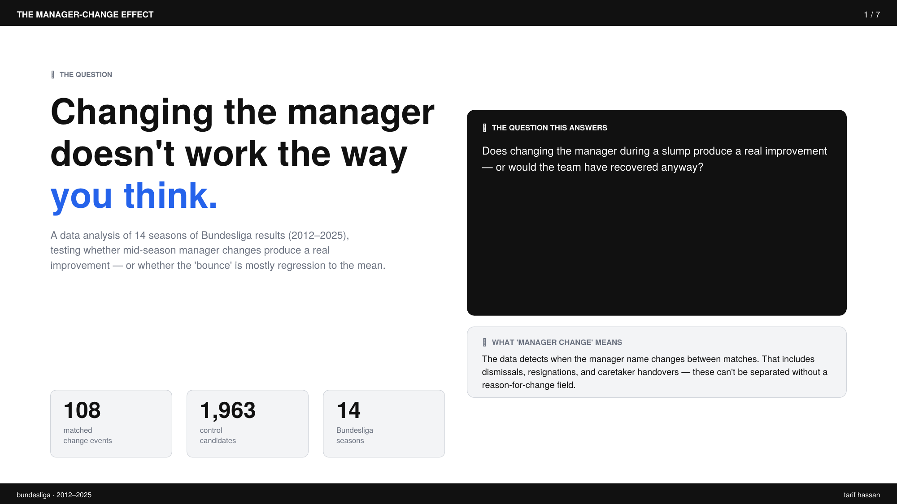
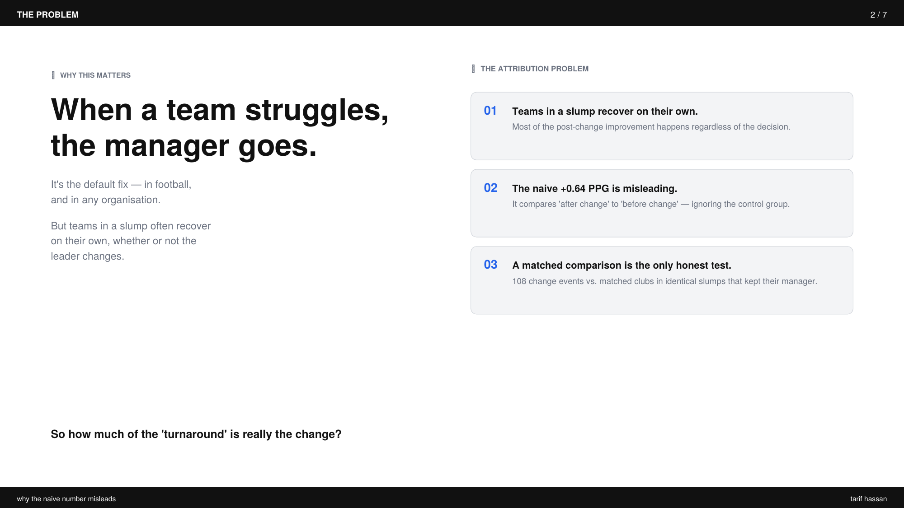
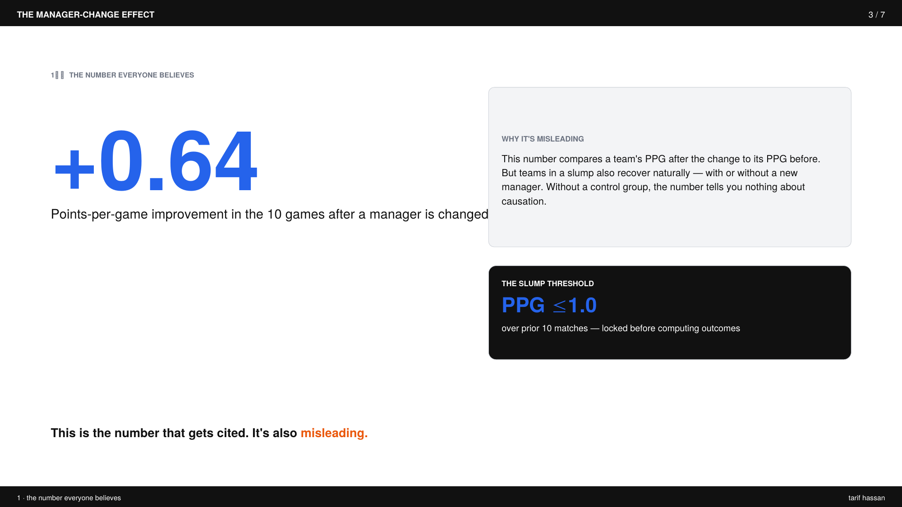
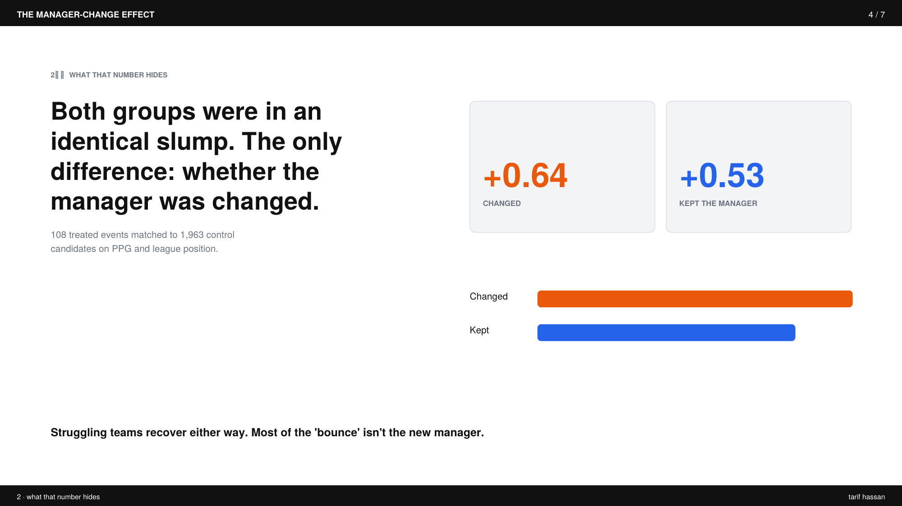
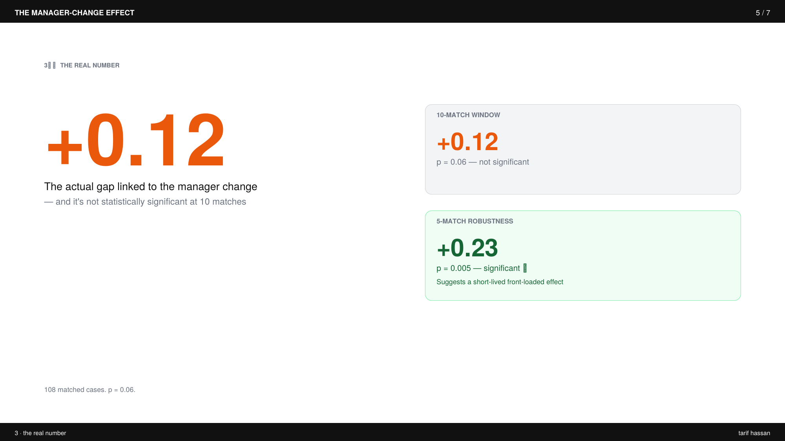
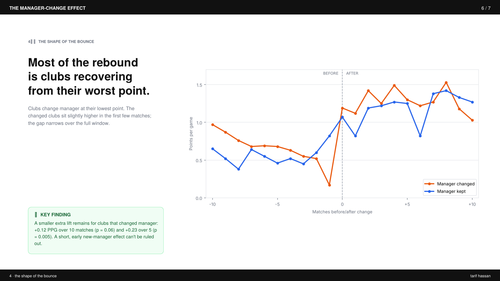
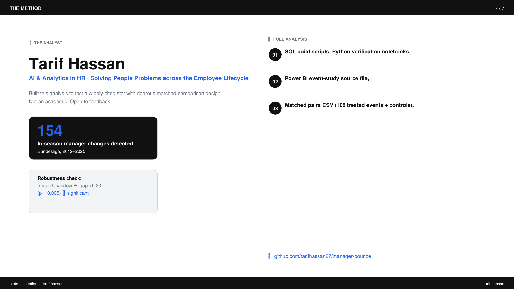

# Does Changing the Manager Mid-Slump Actually Work?

A data analysis of 14 seasons of Bundesliga results (2012–2025), testing
whether mid-season managerial changes produce a real performance
improvement — or whether the "new manager bounce" is mostly regression
to the mean.

## Business problem

When a team underperforms, replacing its leader is the default response —
in football, changing the manager; in an organization, replacing a
struggling department head or team lead. But teams in a slump also tend
to recover on their own, given time. Without a matched comparison, a
recovery that would have happened anyway gets misattributed to the
leadership change.

This project tests that attribution problem directly, using real match
data as a clean, decision-relevant proxy: a mid-slump manager change is a
leadership-change decision made under real time pressure, with a
measurable before/after outcome (points per game), and — critically — a
large enough pool of comparable teams that did *not* change managers to
build a genuine control group. Full framing in
[`01_business_problem/problem_statement.md`](01_business_problem/problem_statement.md).

## The question

Fan and media narratives treat a change of manager as an obvious fix
for a struggling team. But teams in a slump tend to recover somewhat on
their own, whether the manager changes or not. This project isolates the
effect of the change itself by comparing clubs that changed manager to a
matched group of clubs that were in an equally bad slump but kept their
manager.

**What "manager change" means here:** the data detects when the manager
name changes between consecutive matches. That captures dismissals, but
also resignations, mutual-consent exits, managers leaving for another
club, and caretaker handovers. The dataset has no reason-for-change
field, so these can't be separated. Given that every change analysed
happened during a slump, most are likely dismissals — but not all.

## Data

- **Match results and manager records:** Transfermarkt open dataset
  (`dcaribou/transfermarkt-datasets`, mirrored on Kaggle as
  `davidcariboo/player-scores`)
- **Scope:** Bundesliga, 2012/13–2025/26 (14 complete seasons, 88,958
  total matches in the source, 4,284 Bundesliga matches)
- Cross-checked against football-data.co.uk and Wikipedia season pages

## Method

1. Built a match spine: one row per club per match, with points and
   rolling points-per-game (PPG) over the prior 10 and next 10 matches.
2. Detected 154 in-season managerial changes via manager-name changes
   between consecutive matches; excluded 5 changes on the final 1–2
   matchdays as likely end-of-season bench handoffs rather than genuine
   mid-season changes.
3. Defined a "slump" as PPG ≤ 1.0 over the prior 10 matches — locked
   before computing any outcome (see
   [`01_business_problem/definitions.md`](01_business_problem/definitions.md)).
4. Matched each manager change made during a slump (108 events) to the
   closest comparable club-season that stayed in a slump but did not
   change manager, on PPG and league position.
5. Compared PPG change (next 10 − prior 10) between the two groups,
   using a paired t-test and a difference-in-differences regression.

## Result

| | PPG change (next 10 − prior 10) |
|---|---|
| Manager changed | +0.643 |
| Manager kept | +0.526 |
| **Gap linked to the change** | **+0.117** (p = 0.061, not significant) |

Both groups recovered substantially on their own — most of the "bounce"
fans attribute to a new manager happens regardless of whether the
manager actually changes. The change adds a further ~0.12 points per
game on top of that, but this could plausibly be chance at this sample
size (108 matched pairs).

**Robustness check:** using a shorter 5-match window instead of 10, the
gap widens to +0.225 and becomes statistically significant (p = 0.005).
This suggests any real effect may be front-loaded — a short-term jolt
that fades by the 10-game mark — though the 5-match PPG scale is
coarser and likely overstates matching precision. Full detail in
[`03_sql/06_robustness.sql`](03_sql/06_robustness.sql).

The chart below shows the actual match-by-match shape. Clubs that
changed manager bottom out right before the change (PPG 0.17 at match
−1, the lowest point either group reaches) and jump sharply at match 0 —
but so does the control group, and by roughly similar magnitude
(changed: +0.57 PPG from pre- to post-change average; kept: +0.55). The
changed line sits above the kept line in most of the first several
matches after the change, which is exactly what the "misleading" +0.64
headline number picks up. Most of the rebound is clubs recovering from
their worst point. A smaller extra lift remains for clubs that changed
manager: +0.12 PPG over 10 matches (p = 0.06) and +0.23 over 5
(p = 0.005). A short, early new-manager effect can't be ruled out.

## Repo structure

- `01_business_problem/` — the business framing and the locked analysis
  definitions, written before results were computed
- `02_data/` — data-quality notes and exported intermediate datasets
  (raw CSVs excluded via `.gitignore`)
- `03_sql/` — build scripts, one per phase, run in order
- `04_analysis/` — notebooks used to independently verify the SQL
  results in Python
- `05_powerbi/` — Power BI source file for the event-study chart
- `06_executive_brief/` — the LinkedIn carousel deck (PDF + individual
  slide images)

## Limitations

- The data detects manager changes, not dismissals. Resignations,
  mutual-consent exits, departures to another club, and caretaker
  handovers are included alongside sackings and can't be separated
  without a reason-for-change field. Results describe the effect of a
  mid-slump manager change, not of a sacking specifically.
- Matching is with replacement (a control event could be reused across
  multiple treated cases); with 1,963 control candidates vs. 108
  treated events, this risk is low but not zero.
- League position and PPG are the only matching variables; squad
  quality, injuries, and fixture difficulty aren't controlled for.
- Bundesliga only — findings may not generalize to leagues with
  different managerial-change norms.

---

Full carousel also available as a
[PDF](06_executive_brief/Manager_Sackings_Carousel.pdf).
